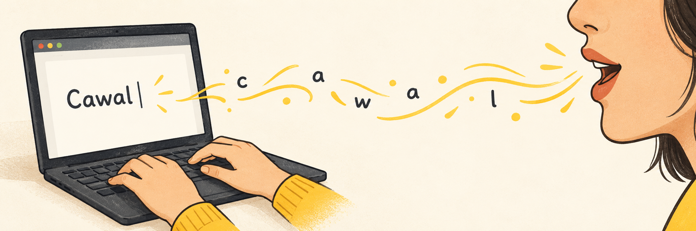

<p align="center">
  
</p>

# Cawal — Cangkem Virtual

Dictation sederhana untuk Windows. Tampilan Quiet Graphite dengan aksen
`#ffdd33` dan logo line art mulut berbicara. Hanya Groq.
Jendela desktop khusus pengaturan **Umum** dan **Koneksi**; dictation lewat shortcut.

Tekan shortcut yang tertera di Cawal (bawaan **Ctrl + Shift + Spasi**), bicara,
lalu tekan lagi. Shortcut dapat diganti lewat **Umum → Shortcut dictation → Ubah**:
tekan kombinasi pilihanmu lalu **Simpan**. Jika shortcut bawaan dipakai aplikasi
lain, Cawal memilih kombinasi alternatif. Shortcut kustom yang bentrok akan
menampilkan pesan agar kamu memilih kombinasi lain. Cawal mentranskripsikan
suara dan menempelkan hasil ke aplikasi yang aktif saat rekaman dimulai.
**Esc** membatalkan rekaman atau pemrosesan.

## Yang tersedia

- Dictation: `whisper-large-v3-turbo` (bawaan) atau `whisper-large-v3`.
- Perapihan opsional: `qwen/qwen3.8-27b`, tanpa thinking atau tools.
  Prompt khusus merapikan kalimat, tanda baca, tanda petik untuk ucapan langsung,
  dan paragraf saat topik berubah. Dictation singkat tetap satu paragraf;
  gaya santai, sisipan Inggris, nama, angka, dan maksud ucapan dipertahankan.
- Satu API key Groq, tersimpan terenkripsi menggunakan perlindungan Windows.
- Bahasa utama Indonesia, dengan konteks ejaan untuk sisipan Inggris seperti About,
  update, settings, dan feedback. AI mempertahankan campuran bahasa dan gaya bicara.
- Mikrofon, shortcut kustom, dan mulai bersama Windows.
- Indikator rekaman kecil, salin ulang saat paste gagal, dan coba ulang saat error.

Tidak ada akun Cawal, langganan aplikasi, meeting, notes, chat, agent, upload,
provider lain, model lokal, sinkronisasi, telemetry, atau updater OpenWhispr.
Biaya dan batas penggunaan API mengikuti akun Groq milik pengguna.

## Pakai

1. Pasang `Cawal-Setup-1.4.2.exe` dari folder `dist/releases/1.4.2`.
2. Buka Koneksi, simpan API key Groq, lalu pilih Tes koneksi.
3. Pilih mikrofon di Umum bila perlu. Letakkan kursor pada kolom teks aplikasi tujuan.
4. Tekan shortcut untuk mulai dan selesai bicara.

Setelah API key tersimpan, pembukaan berikutnya langsung berjalan di background.
Tombol minimize dan tutup menyembunyikan Cawal ke tray. Klik dua kali ikon tray
untuk membuka pengaturan; pilih Keluar pada menu tray untuk berhenti sepenuhnya.
Aktifkan “Mulai bersama Windows” jika ingin Cawal mulai bersama Windows.

Tekan shortcut dari aplikasi mana pun: ikon gelombang kecil (88 × 56 piksel)
muncul di bawah monitor aplikasi tempat kamu mengetik, meskipun pointer mouse
berada di monitor lain. Flow Line berupa satu garis #ffdd33 pada latar hitam,
mengalir mengikuti level suara mikrofon dengan respons halus dan peluruhan
170 ms. Garis merata saat hening, tanpa teks, durasi, atau tombol. Ikon tidak
mengambil fokus maupun menghalangi klik ke aplikasi di bawahnya. Shortcut lagi
menyelesaikan rekaman; Esc membatalkannya. Ikon diam saat memproses dan
menghilang setelah selesai. Pesan pemulihan saat paste gagal atau error tersedia
di jendela pengaturan. Tidak ada dashboard atau panel transkrip.
Mikrofon hanya aktif selama rekaman, bukan selama Cawal menunggu di background.
Rekaman dibatasi lima menit dan 24 MB. Internet diperlukan.
Bahasa Indonesia aktif otomatis, termasuk untuk pengaturan dari versi lama.
Contoh hasil yang dituju: “Buka halaman About, lalu update settings-nya.”
Kata Indonesia seperti “tentang” tetap Indonesia. Tidak ada penggantian kata
otomatis berbasis kamus. Akurasi campuran bahasa tetap bergantung pada audio
dan model; perapihan AI tidak dapat memulihkan ucapan yang hilang dari transkrip.
Konteks transkripsi mengikuti [panduan prompting Groq](https://console.groq.com/docs/speech-to-text#prompting-guidelines).
Jika AI gagal, teks asli Whisper tetap digunakan. Jika transkripsi gagal,
rekaman disimpan sementara di memori untuk dicoba ulang. Coba ulang hanya
menyalin hasil ke clipboard, karena aplikasi tujuan awal bisa sudah berubah.

Hasil terakhir dan audio tidak disimpan ke disk oleh Cawal. Keduanya hilang
saat aplikasi keluar. Teks yang sudah disalin tetap ada di clipboard Windows sampai diganti.
Pengaturan dan API key terenkripsi ada di `%APPDATA%/Cawal/settings.json`,
terpisah dari data OpenWhispr. Audio dikirim ke Groq; jika AI diaktifkan,
transkrip juga dikirim ke Groq untuk dirapikan.

Qwen 3.8 berstatus preview di Groq. Jika model tidak tersedia untuk akunmu,
matikan Rapikan dengan AI untuk memakai Whisper saja. Tidak ada pergantian
otomatis ke model atau provider lain.

Paste otomatis menggunakan Windows SendInput. Aplikasi yang berjalan sebagai
administrator atau tidak menerima paste mungkin perlu Ctrl+V secara manual.
Untuk terminal yang dikenali, helper menggunakan Ctrl+Shift+V.

## Pengembangan

Windows x64, Node.js 24+, dan .NET Framework 4.x (compiler bawaan Windows).

```powershell
npm install
npm run dev
```

```powershell
npm run check        # typecheck, unit/integration tests, renderer build
npm run test:desktop # Electron smoke test with a fake microphone; no API call
npm run build:win    # Windows installer
```

Struktur: `app/` untuk Electron dan Groq, `renderer/` untuk antarmuka,
`native/Paste.cs` untuk paste Windows, `tests/` untuk pengujian.
Build tidak mengunduh mesin/model AI atau layanan tambahan. Installer lokal
tidak ditandatangani; Windows dapat menampilkan peringatan penerbit belum dikenal.

## Lisensi

Cawal merupakan penyederhanaan proyek OpenWhispr. Hak cipta dan lisensi MIT
OpenWhispr dipertahankan di `LICENSE`. Helper paste mengadaptasi perilaku
deteksi terminal dan pemulihan fokus dari helper Windows OpenWhispr.
